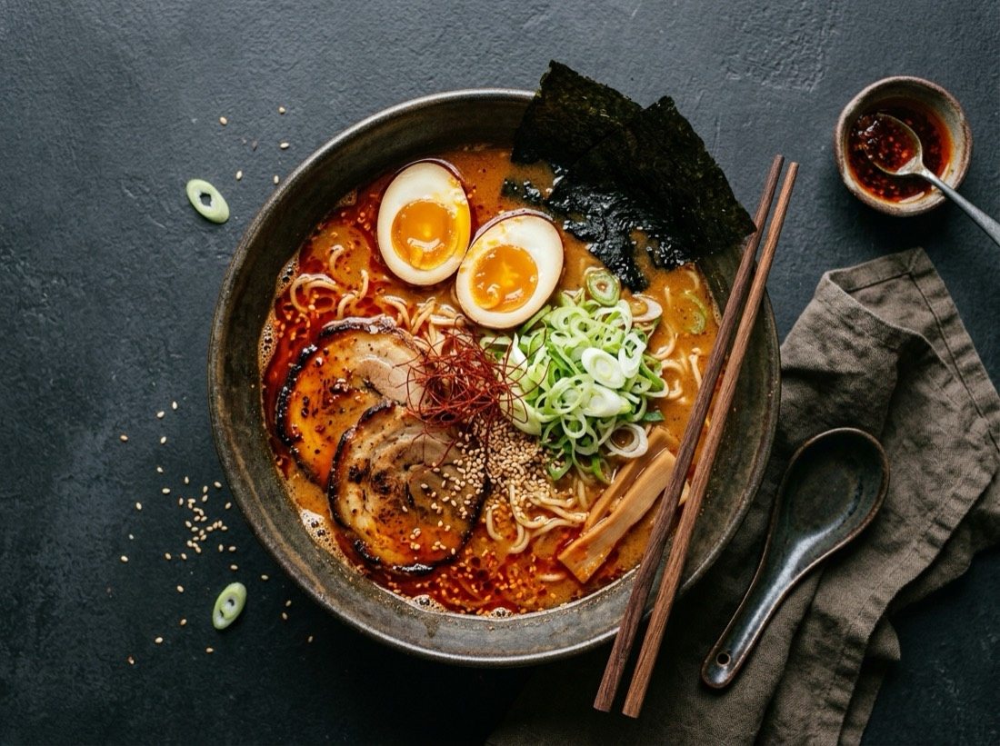
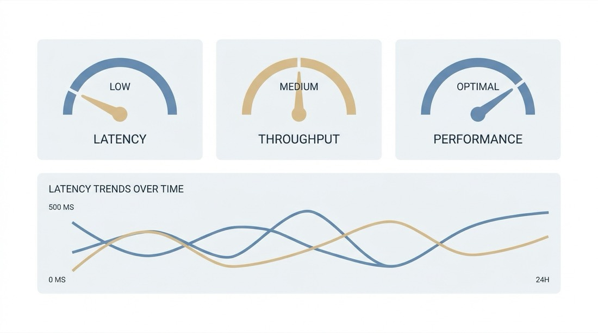

# MAI-Image-2.6 API (`mai-image-2.6`)

<!-- conv-kit:v1 -->

<p align="center">
    
</p>

<p align="center">
  
</p>

> **$30.40 per million output-image tokens** (effective) — text and reference input billed separately, one PNG per request — one OpenAI-compatible endpoint at `https://api.apimart.ai/v1`, no monthly plan required. *(observed 2026-10-12)*

**[Get an API key](https://go.apimart.ai/k-e5e77f)** · **[Live pricing](https://go.apimart.ai/k-300b9f)** · **[Model page](https://go.apimart.ai/k-00ec13)** · [⚡ 60-second quickstart](#quickstart)

**Why teams call MAI-Image-2.6 (`mai-image-2.6`) through APIMart**

- **One key, entire catalog.** The same `https://api.apimart.ai/v1` base URL and `Authorization` header reach MAI-Image-2.6 and 300+ other image, video and language models — switch the `model` field, not your client.
- **$1 minimum, pay as you go.** No subscription and no prepaid plan to size up front: top up from $1 and spend it on calls. There is no free quota to burn through first, so the price in this table is the price you pay.
- **The charge comes back in the response.** Every completed task reports the amount billed (`cost` / `credits_cost`), so a spend number is read per call instead of guessed at month end. A task marked `failed` is refunded.
- **Async by design.** Submit, take the `task_id`, poll `GET /v1/tasks/{id}` — batching and retries are ordinary queue work, not a bespoke integration.

<!-- /conv-kit:v1 -->


Microsoft's MAI-Image-2.6 and MAI-Image-2.6 Flash support text-to-image, reference editing and multi-image composition. Each request produces one PNG and is billed for actual text-input, reference-image and output-image tokens.

## Model id and routes

| Route | `model` value | Billing | Images per task | Notes |
| --- | --- | --- | --- | --- |
| Quality | `mai-image-2.6` | per million tokens (text input + reference input + image output) | 1 PNG | prioritises image quality |
| Flash | `mai-image-2.6-flash` | per million tokens, lower rates | 1 PNG | faster and lower-priced, same inputs and parameters |

Endpoint: `POST https://api.apimart.ai/v1/images/generations` (OpenAI-compatible), then poll `GET /v1/tasks/{task_id}`.
Result links expire **72 hours** after completion.

## Pricing

<!-- pricing:model:start -->
| Output | List price | Effective price |
| --- | --- | --- |
| default | $0.0375 | $0.02 |
| 4K | $0.05 | $0.03 |

The token-billed official route bills per million tokens instead: `text_input` $1.60, `cached_text_input` free, `image_input` $1.60, `cached_image_input` free, `text_output` $9.60, `image_output` $96.00.
<!-- pricing:model:end -->

Failed tasks are fully refunded. A 3072×768 request is valid (multiples of 32, each side ≥ 768 px). Prices are a snapshot; the [Live pricing](https://go.apimart.ai/k-300b9f) page and [`data/model.json`](data/model.json) are refreshed by CI, and a completed task reports the exact amount in its `cost` field.

## Request parameters

| Field | Type | Default | Notes |
| --- | --- | --- | --- |
| `model` | string | required | `mai-image-2.6` (quality) or `mai-image-2.6-flash` (faster, cheaper) |
| `prompt` | string | required | photograph, poster or product scene — include composition, lighting and any text |
| `resolution` | string | `1K` | `1K` or `2K`; **4K is not supported** |
| `size` | string | `auto` | integer aspect ratio from `1:4` to `4:1`, or `auto` |
| `width` / `height` | integer | — | exact pixel sizes: each side ≥ 768 px, total ≤ 2,359,296 px, multiples of 32 (e.g. 3072×768) |
| `image_urls` | string[] | — | up to five references as HTTP(S) URLs or Base64 data URLs; JPEG and PNG supported, WebP and GIF converted to PNG |
| `web_grounding` | boolean | `false` | retrieve current information with Bing before generating people, places or events |

**Reference images.** Up to **five** references. For image editing the model chooses the output dimensions from the references — `size`, `resolution`, `width` and `height` do not control the result.

Supported aspect ratios: `auto` plus integer ratios from `1:4` to `4:1`.

## Quickstart

```bash
curl --request POST --url https://api.apimart.ai/v1/images/generations \
  --header "Authorization: Bearer $APIMART_API_KEY" --header 'Content-Type: application/json' \
  -d '{"model":"mai-image-2.6","prompt":"A bamboo forest path under moonlight","size":"1:1","resolution":"1K"}'
```

```python
import os, time, requests

BASE = "https://api.apimart.ai/v1"
HEADERS = {"Authorization": f"Bearer {os.environ['APIMART_API_KEY']}", "Content-Type": "application/json"}

created = requests.post(f"{BASE}/images/generations", headers=HEADERS, timeout=60, json={
    "model": "mai-image-2.6", "prompt": "A bamboo forest path under moonlight",
    "size": "1:1", "resolution": "1K",
}).json()
task_id = created["data"]["id"]

while True:
    task = requests.get(f"{BASE}/tasks/{task_id}", headers=HEADERS, timeout=60).json()["data"]
    if task["status"] in ("completed", "failed"):
        break
    time.sleep(5)
print(task.get("cost"), task["result"]["images"][0]["url"])
```

```javascript
const res = await fetch("https://api.apimart.ai/v1/images/generations", {
  method: "POST",
  headers: { Authorization: `Bearer ${process.env.APIMART_API_KEY}`, "Content-Type": "application/json" },
  body: JSON.stringify({ model: "mai-image-2.6", prompt: "A bamboo forest path under moonlight",
                          size: "1:1", resolution: "1K" }),
});
const { data } = await res.json();      // data.id is the task id — poll /v1/tasks/<id>
```

Runnable versions: [`examples/`](examples). The task lifecycle is `pending → processing → completed | failed`.

## Sample outputs

Each row is one API call. Costs follow the price table above.

| Output | Recipe | Ratio | Cost | Prompt |
| --- | --- | --- | --- | --- |
|  | Product / e-commerce | 1:1 | tokens | `Studio hero shot of a frosted glass perfume bottle on a wet black stone slab, single softbox from the left, faint mist, deep charcoal background, crisp label text, commercial product photography` |
|  | Food photography | 4:3 | tokens | `Overhead flat lay of a spicy miso ramen bowl with soft boiled egg, nori and scallions, dark ceramic table, chopsticks resting on the rim, natural window light, editorial food photography` |
|  | Cinematic still | 16:9 | tokens | `Rain soaked Kyoto alley at night, paper lantern reflections on wet stone, a lone figure with a transparent umbrella walking away, cinematic 35mm still, shallow depth of field, film grain` |
|  | Architecture | 16:9 | tokens | `Minimalist concrete villa on a cliff at dusk, warm interior light, infinity pool reflecting a violet sky, architectural photography, 24mm perspective, ultra sharp` |
|  | Fashion portrait | 3:4 | tokens | `Editorial fashion portrait of a model in an oversized ivory wool coat, seamless light grey studio backdrop, crisp high key lighting, medium format detail, calm expression` |
|  | Illustration | 1:1 | tokens | `Layered paper cut illustration of a mountain lake at sunrise, five depth layers, soft pastel palette, subtle drop shadows, art print composition, clean vector edges` |
|  | Design / UI | 16:9 | tokens | `Flat vector dashboard panel showing three gauge dials and abstract latency curves, muted blue and sand palette, generous white space, crisp geometric cards, no placeholder text` |
|  | Macro nature | 3:2 | tokens | `Macro photograph of a dew covered dandelion seed head against deep black background, focus stacked detail, iridescent droplets, studio lighting` |

Sources and costs are also in [`data/samples.json`](data/samples.json).

## FAQ

**What is the MAI-Image-2.6 model id?**

`mai-image-2.6`. See the route table above for the exact values this model accepts.

**How is a MAI-Image-2.6 image billed?**

Token rates (effective): `text_input` $4.00, `image_input` $6.40, `image_output` $30.40 per million tokens. Flash is cheaper: $1.40 / $2.00 / $15.20.

**How long do result links last?**

72 hours after completion — read `expires_at` and copy the files out.

**What happens if a task fails?**

A task marked `failed` is refunded and reports `cost = 0`. A network error while polling status does not by itself mean the task failed — re-query the task id.

## Attributed links (how this repository is measured)

| Purpose | Attributed link | Target |
| --- | --- | --- |
| Model page | <https://go.apimart.ai/k-00ec13> | `apimart.ai/model/mai-image-2-6` |
| Live pricing | <https://go.apimart.ai/k-300b9f> | `apimart.ai/pricing` |
| Get an API key | <https://go.apimart.ai/k-e5e77f> | `apimart.ai/keys` |

Outbound APIMart links are minted through the promo link API; hand-made tracking parameters are rejected by
`tools/check_links.py` in CI.

## Disclosure

MAI-Image-2.6 is a third-party model served through APIMart; this repository documents how to call it and publishes
model ids and prices, and does not claim official status. Model names, prices and documentation belong to their
respective owners. The renders in this README were produced through the APIMart image API and are shown as examples
of the API's output.

## Repository map

```text
README.md             model id, routes, pricing, parameters, quickstart, samples, FAQ
data/model.json       the pricing record for this model (CI-refreshed)
data/samples.json     prompt recipes used for the sample renders
tools/check_links.py  attribution guard
examples/             curl, Python and JavaScript clients
assets/               sample renders (JPEG, resized for the README)
```

## License

MIT — see [LICENSE](LICENSE).
